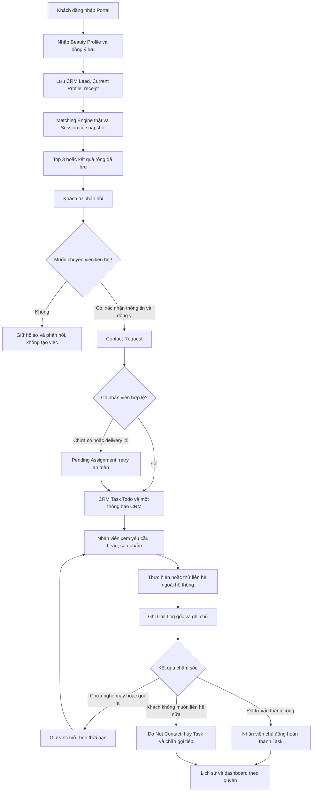

# BeautyMatch — nghiệp vụ cuối: tự nhận gợi ý và chăm sóc có đồng ý

Cập nhật **07/11/2026**, nhánh `fix/beautymatch-final-demo`, baseline `31a7633a844cf7bc448558e879c41915bbeaefc6`. Frappe 15.121.3, CRM 1.86.0, Docker local `crm-frappe-1`, site `crm.localhost`. Không commit/push/merge.

## 1. Luồng nghiệp vụ

**Quan tâm là sở thích; đồng ý được liên hệ là một quyết định riêng.** Không tạo Task, Deal, Call Log hoặc thông báo yêu cầu liên hệ chỉ vì khách đăng nhập, điền hồ sơ, xem kết quả hoặc nhấn Quan tâm.

## 2. Portal và CRM cùng một hệ thống

| Customer Portal                                                  | Staff CRM                                                            |
| ---------------------------------------------------------------- | -------------------------------------------------------------------- |
| Website User, role BeautyMatch Customer                          | System User, Sales User/Sales Manager theo quyền CRM                 |
| Hồ sơ, session, feedback và trạng thái liên hệ của mình          | Lead được phép, Task, snapshot, ghi chú nội bộ, Call Logs và báo cáo |
| Nhận gợi ý ngay, không chờ tiếp nhận                             | Chủ động tư vấn tại cửa hàng hoặc chăm sóc yêu cầu khách đã đồng ý   |
| Không truy cập CRM shell, dữ liệu khách khác hoặc ghi chú nội bộ | Mọi action nghiệp vụ kiểm tra role và quyền Lead ở backend           |

BeautyMatch là **Custom App mở rộng CRM**: Lead là định danh khách thống nhất; profile và matching session liên kết với Lead; công việc và cuộc gọi sử dụng DocType CRM thật; giao diện nhân viên nằm trong Vue Router/Pinia/layout/phiên đăng nhập của `/crm`. Không dựng dashboard CRM giả hoặc cơ sở khách hàng tách riêng.

## 3. Dữ liệu và liên kết

| DocType                             | Trách nhiệm                                                                                                                                              |
| ----------------------------------- | -------------------------------------------------------------------------------------------------------------------------------------------------------- |
| User                                | Xác thực; khách vẫn là Website User, không được cấp Sales/System Manager                                                                                 |
| BeautyMatch Customer Account        | Mapping duy nhất giữa tài khoản khách và CRM Lead                                                                                                        |
| CRM Lead                            | Họ tên, email tài khoản, số liên hệ được phép và Lead Owner; không tự chuyển Deal                                                                        |
| Beauty Profile                      | Một hồ sơ hiện tại cho Lead; loại da, 1–3 vấn đề, nhạy cảm, nhu cầu, budget, tránh thành phần, thương hiệu, consent                                      |
| Consultation Submission             | Receipt UUID/hash/version chống gửi trùng                                                                                                                |
| Recommendation Session              | Snapshot hồ sơ/settings/thuật toán tại thời điểm tạo; origin Customer/Staff/Legacy, customer_user khi khách tự phục vụ                                   |
| Recommendation Item                 | Snapshot sản phẩm/giá/ảnh/thành phần, điểm/lý do/cảnh báo, phản hồi và nguồn Customer/Staff                                                              |
| **BeautyMatch Contact Request mới** | Đồng ý liên hệ riêng: customer, Lead, session, sản phẩm đã chọn, channel, contact đã xác nhận, thời gian, ghi chú, người nhận, Task, trạng thái delivery |
| CRM Task                            | Công việc chăm sóc thật, tham chiếu Lead/session/Contact Request, nhân viên, hạn và trạng thái                                                           |
| CRM Notification                    | Bell thực tế của CRM 1.86.0; dùng thông báo assignment native của Task và đổi đích đến Contact Request                                                   |
| CRM Call Log                        | Call Logs gốc: cuộc gọi thủ công đã thực hiện/thử, caller, from/to, thời điểm, duration nếu biết, status, Lead, Task qua links                           |
| FCRM Note                           | Nội dung trao đổi nội bộ, đúng Lead; không trả cho Portal                                                                                                |
| BeautyMatch Customer Request cũ     | Giữ lịch sử request Pending/In Progress/Completed/Superseded cũ; không dùng làm Contact Request                                                          |

Session mới không ghi đè snapshot session cũ. Contact Request giữ bản xác nhận riêng, không suy ra consent từ feedback. Native Task có thêm Link Contact Request; Call Log có Link Contact Request, outcome, cờ DEMO và khóa/hash retry. Không sửa core CRM hoặc tạo DocType cuộc gọi thay thế.

## 4. API và quy tắc giao dịch

[Self service API](../beautymatch/api/self_service.py):

- `recommend(payload)`: xác thực khách, ràng buộc email tài khoản/mapping, validate và khóa account/request/contact; lưu Lead/profile/receipt; dùng hàm persistence chung của recommendation để chạy engine thật và lưu session/items trong cùng giao dịch. Rỗng vẫn lưu session.
- `get_result(session_id)`: kiểm tra Lead mapping **và customer_user**; chỉ trả snapshot sản phẩm/hồ sơ, contact options và request của khách; không trả ghi chú/Task nội bộ.
- `history()`: 30 phiên tự phục vụ mới nhất của đúng tài khoản. Kết quả restore từ server/sessionStorage, không gọi generation khi reload.
- `submit_feedback(...)`: chỉ item trong session của khách; nguồn ghi tự động Customer, không nhận nguồn hoặc Lead do client chỉ định.
- `record_staff_feedback(...)` và endpoint cũ `feedback.submit_feedback`: giữ role/Lead read+write, nguồn Staff; chỉ ghi phản hồi, không tạo/mở lại/hủy công việc do thay đổi sở thích.

Entry cũ `portal.submit_profile` chuyển tiếp sang instant self-service; không còn lối công khai tạo notification chỉ vì gửi profile. Helper dựng request lịch sử chỉ là hàm private không whitelisted. Các endpoint nhân viên đọc/tiếp tục request cũ vẫn giữ để bảo toàn lịch sử.

[Customer care API](../beautymatch/api/customer_care.py):

- `request_contact(session_id,payload)`: kiểm tra own session, 1–3 item Interested, channel Phone/Email, contact khớp dữ liệu Lead/account và consent riêng. UUID/hash bất biến, khóa session chống đồng thời; intent giống hệt đang mở được tái sử dụng cả khi browser mất retry key.
- `request_staff_contact(...)`: cùng quy tắc, nhân viên ghi nhận sự đồng ý rõ ràng sau tư vấn trực tiếp.
- Giao Task/notice trong savepoint riêng. Lỗi delivery giữ request Pending Assignment/Failed, không trả CREATED khi chưa có Task. Retry UUID không trùng; scheduler hoặc nhân viên mở request có quyền có thể giao lại. Không có người nhận hợp lệ thì giữ PENDING.
- Người nhận ưu tiên Lead Owner có quyền thật, ToDo Open, rồi default assignee nếu thực sự có read/write Lead. Không broadcast, không mặc định gửi Administrator.
- Task mặc định **Todo**, tiêu đề nhu cầu + khách, hạn theo Settings, description từ dữ liệu xác nhận đã escape. Native ToDo assignment và Task thật được sử dụng bằng service write giới hạn sau authorization; không cấp quyền Task tổng quát cho Website User, không impersonate Administrator.
- Tái sử dụng native CRM Notification assignment, không thêm bell entry thứ hai cho cùng Contact Request. Self-assignment không phát native notification thì tạo đúng một row. Realtime phát sau commit; read/unread dùng API CRM gốc.
- Override đọc notification chỉ đổi route của BeautyMatch, giữ notification CRM khác. `/crm/beautymatch/contact/:leadId` chứa UUID request, kiểm tra Lead phía server; không chứa tên/email/phone.

## 5. Cuộc gọi và vòng đời công việc

Đã khảo sát CRM 1.86.0: trang Call Logs dùng DoctypeModal tạo **CRM Call Log**; detail gọi `crm.fcrm.doctype.crm_call_log.crm_call_log.get_call_log`. Schema gốc có `from`, `to`, `caller`, `type`, `telephony_medium`, `status`, `start_time`, `duration`, `end_time`, `reference_doctype/reference_docname`, `note` và bảng Dynamic Link `links`.

Màn hình **Yêu cầu liên hệ** ghi thủ công qua controller DocType gốc, quyền create/write chuẩn của nhân viên, và kiểm tra thêm quyền Lead/Contact/Task. Không thực hiện cuộc gọi tự động từ website. Chỉ bấm lưu sau khi đã thực hiện/thử liên hệ; demo giả lập phải chọn cờ DEMO. Note title, medium và timeline đều có nhãn.

| Kết quả nghiệp vụ        | Native Call Log status | Xử lý Task                                             |
| ------------------------ | ---------------------- | ------------------------------------------------------ |
| Đã tư vấn thành công     | Completed              | Vẫn mở; nhân viên chủ động hoàn thành sau đó           |
| Khách chưa nghe máy      | No Answer              | Không hoàn thành; có thể hẹn lại                       |
| Khách yêu cầu gọi lại    | Completed              | Giữ việc mở, cập nhật due_date                         |
| Khách muốn tìm hiểu thêm | Completed              | Giữ việc để tiếp tục chăm sóc                          |
| Khách không còn nhu cầu  | Completed              | Hủy Task, Contact Request Do Not Contact, chặn gọi mới |

`record_call` khóa state và UUID call; payload hash khác dưới cùng UUID bị từ chối. Retry cuộc gọi đã lưu không tạo thêm Note/Call, kể cả request đã kết thúc. Mỗi call liên kết đúng Lead và Task, Note phải thuộc cùng Lead. Thời điểm được chuyển về timezone site; API trả ISO có offset cho giao diện.

Hoàn thành Task Phone cần có call outcome Consulted; Call Log không tự hoàn thành Task. Native Task Done đồng bộ request Completed. Native Task Canceled đồng bộ request Canceled, không đếm là việc đang chờ chăm sóc và không cho gọi tiếp/mở lại từ sở thích. Khi khách có nhu cầu mới cần một xác nhận liên hệ mới. Task lịch sử không bị xóa.

Email là lựa chọn nếu có email hợp lệ: tạo công việc và nhân viên liên hệ ngoài hệ thống/CRM email theo sự đồng ý; không tạo Call Log giả cho email. Đánh dấu hoàn thành qua Task native sau khi thực sự làm xong.

## 6. Dashboard và lịch sử

Bốn KPI và hai biểu đồ gốc vẫn từ backend thật: total_sessions, leads_with_profile, interest_rate, average_top1_score; top_skin_concerns và top_interested_products. Interest rate là tỷ lệ session có ít nhất một item Interested; không phải số cuộc gọi.

Sáu số chăm sóc mới: tổng Contact Request, request chờ chăm sóc, Task đang xử lý, Task Done, Call Log đã ghi nhận và khách cần liên hệ lại. Có số DEMO calls riêng, không trình bày cuộc gọi giả lập là cuộc gọi khách thật. Callback xét kết quả mới nhất của request còn hoạt động. Tất cả lọc bằng Lead có quyền, đối chiếu SQL độc lập trong audit.

Hồ sơ & lịch sử trong CRM hiển thị profile hiện tại, session/items/điểm, feedback và nguồn phản hồi, yêu cầu liên hệ, Task, timeline cuộc gọi và ghi chú. Portal chỉ thấy dữ liệu của mình, không thấy note nội bộ. Request cũ giữ trong mục phiên bản trước.

## 7. Cài đặt và demo 10 phút

Xem lệnh triển khai, tài khoản và bằng chứng tại [DEMO_SEMINAR_READY](DEMO_SEMINAR_READY.md). Hai build cần hoàn tất trước restart. Seed không reset mật khẩu; dữ liệu nghiên cứu/engine giữ nguyên.

| Thời gian  | Thao tác trình bày                                                                                       |
| ---------- | -------------------------------------------------------------------------------------------------------- |
| 0:00–1:00  | Nêu CRM Lead là khách thống nhất; đăng nhập khách trong browser riêng                                    |
| 1:00–2:30  | Hồ sơ Nguyễn Minh Anh, Combination, Oil Control/Acne/Aging, Serum, 325000; xác nhận lưu, nhận Top 3 ngay |
| 2:30–3:30  | Giải thích điểm/lý do/cảnh báo thật; Quan tâm Top 1, chứng minh chưa có công việc liên hệ                |
| 3:30–4:30  | Chọn muốn liên hệ, Phone nếu có số xác nhận, checkbox consent riêng, gửi và xem mã                       |
| 4:30–5:30  | Đăng nhập tư vấn viên, bell realtime, mở đúng request, Lead và Task Todo                                 |
| 5:30–7:00  | Ghi một cuộc gọi **giả lập DEMO** No Answer, xem Native Call Log; Task vẫn mở; hẹn lại                   |
| 7:00–8:00  | Ghi DEMO Consulted, sau đó chủ động hoàn thành Task; giải thích không tự hoàn thành chỉ vì ghi call      |
| 8:00–9:00  | Lịch sử session/feedback/nguồn phản hồi, timeline Task/Call; hồ sơ mới không ghi đè điểm cũ              |
| 9:00–10:00 | Quản lý xem KPI/charts/care metrics thật; giới hạn catalog, DEMO call và phân quyền                      |

Không gọi số điện thoại demo thật. Các bản ghi minh họa có nhãn, không trình bày như đã liên hệ khách thật.

## 8. Kiểm thử và giới hạn

Bộ kiểm thử v2: [browser](../scripts/verify_self_service.mjs), [audit database thật](../beautymatch/scripts/self_service_audit.py), [TASK4 cập nhật](../beautymatch/tests/test_task4_api.py), [unit message](../tests/frontend/self-service.test.mjs). Không mock response API trong browser/audit. TASK4 giữ ba test generation và sáu test feedback, thay assertion tự tạo Task bằng consent riêng, giữ kiểm tra không trùng và không tự mở lại việc đã hủy. Chi tiết kết quả cuối và checklist 22 tình huống ở tài liệu demo.

- Các script seminar/P0/request browser **v1** vẫn được giữ, mô tả mô hình Pending → staff generate cũ; không dùng chúng làm PASS của nghiệp vụ v2. Các API creation/feedback v1 đổi có chủ đích theo yêu cầu mới; không công bố test cũ là đã đạt trên contract mới.
- Không tích hợp tổng đài hoặc gửi email khách tự động; Call Log thủ công cần nhân viên xác nhận, demo có nhãn.
- Portal hiển thị tối đa 30 session tự phục vụ, 20 contact của session; CRM Care hiển thị tối đa 50 request và 50 call/request. Dữ liệu lâu hơn còn trong DB; chưa có phân trang Care cho quy mô lớn.
- Số điện thoại đang gắn Lead không tự ghi đè khi đổi sang số khác; cần nhân viên xác minh theo quy tắc nhận diện an toàn hiện có. Không có OTP xác minh điện thoại.
- Catalog local 68 hồ sơ, 5 Active; ảnh thiếu có fallback nhãn. Không sửa engine/claim để ép kết quả. Không dùng số liệu Task 3 môi trường khác làm counts hiện tại.
- Permission hooks chỉ bổ sung điều kiện cho Task/Call/Note có Link Contact Request BeautyMatch; kiểm tra cả Link lưu trong DB để không thể đổi payload/gỡ Link nhằm vượt quyền. Note cũ chỉ backfill khi khớp Lead và Call Log của app; records CRM khác giữ nguyên cơ chế gốc. Bridge SPA từ trước vẫn cần review khi nâng CRM; không thêm patch core lần này.
- Scheduler/worker cần chạy để retry nền; thiếu Lead Owner hợp lệ thì quản lý phân công Lead trong CRM, mở lại request để retry. Không gửi nhầm Administrator để che lỗi cấu hình.
- Chưa kiểm thử thiết bị iOS/Android vật lý; desktop/mobile/dark kiểm tra bằng Chrome/Playwright. Axe chỉ vùng được quét, không chứng nhận toàn CRM.
